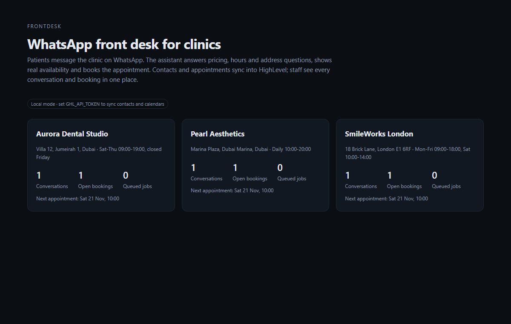
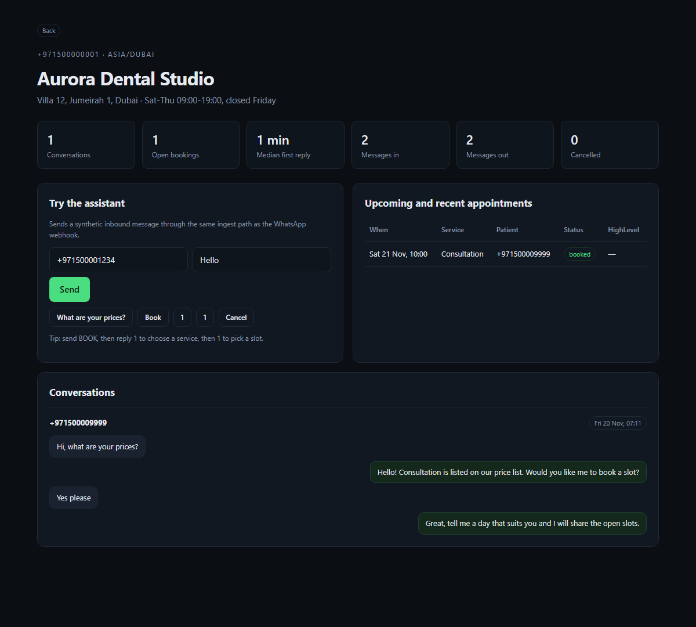
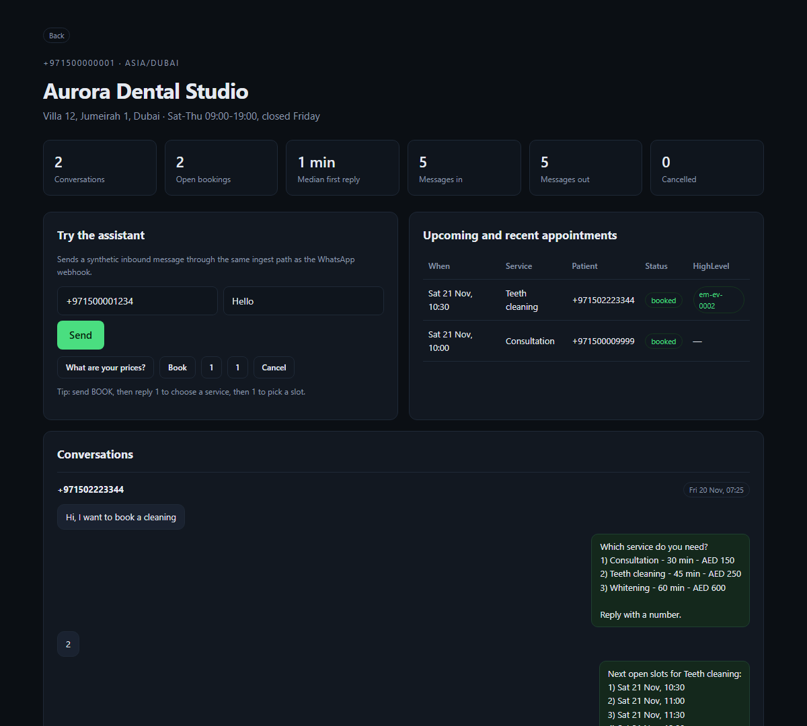

# Frontdesk

WhatsApp front desk for clinics, built on top of HighLevel.

Patients message a clinic's WhatsApp number. The assistant answers pricing, hours and
location questions, shows real availability, books or cancels appointments, and sends
reminders. Contacts and calendar events are mirrored into HighLevel, so the clinic keeps
working inside the CRM it already pays for. Staff see every conversation, booking and
response-time metric in one dashboard.

Status: early build (v0.1). The WhatsApp and HighLevel integrations are implemented and
covered by tests; neither has been run against live credentials yet (see "Verification").

## Live demo

- App: <https://frontdesk-clinic.vercel.app>
- Source: <https://github.com/abhinavshukla152005-beep/frontdesk>

### Try it in 60 seconds

1. Open <https://frontdesk-clinic.vercel.app> and pick **Aurora Dental Studio**.
2. In the "Try the assistant" box send `Hello`, then `Book`, then `1`, then `1`.
3. You get a booking confirmation with a real slot from the availability grid. Send
   `CANCEL` to cancel it, or `What are your prices?` / `What are your hours?` for the FAQ path.

That uses the same ingest path as the WhatsApp webhook, including message dedupe and the
job queue.

### Where the engineering is

| File | What it shows |
| --- | --- |
| `lib/agent.ts` | Conversation state machine: FAQ, service choice, slot choice, cancel, hand-off |
| `lib/booking.ts` | Availability from working hours, lead time and buffer; booking and cancellation |
| `lib/schema.ts` | Partial unique index that makes double booking impossible at the DB level |
| `lib/queue.ts`, `lib/worker.ts` | DB-backed jobs with exponential backoff; CRM outbox to HighLevel |
| `lib/crm/highlevel.ts` | HighLevel API v2 client behind a small interface |
| `tests/` | 23 Vitest tests: double-booking race, DST/timezone edges, webhook idempotency, Graph API delivery, CRM contract |







The third screenshot is from a local run against the HighLevel emulator
(`npm run ghl:mock`): the appointment carries the external id returned by the CRM, which
the dashboard shows in the HighLevel column.

The hosted demo is a free Vercel deployment, so each serverless instance has its own
ephemeral SQLite file. The chat works because the browser carries the conversation state
between turns, but the dashboard tables may show a different instance's data than the chat
just wrote. For the full data flow, including HighLevel sync, run it locally as below.

The phone box on the demo is just a conversation key. **Typing a real number there does
not send anything to WhatsApp** — the demo renders the assistant's replies in the page. See
"WhatsApp delivery" for what real sending requires.

## WhatsApp delivery

Replies are written to the local ledger by the agent, then delivered by a queued
`whatsapp_send` job calling the Graph API (`POST /{phone-number-id}/messages`). Delivery is
a separate job from the agent run, so a failed send retries with backoff instead of
re-running the assistant and duplicating replies. Demo-origin jobs are tagged
`source: "demo"` and are never sent, and demo bookings do not schedule reminder sends.

To send real messages you need a Meta WhatsApp Business account:

1. Create a Meta app with the WhatsApp product and register a business phone number.
2. Set `WHATSAPP_ACCESS_TOKEN`, `WHATSAPP_PHONE_NUMBER_ID`, `WHATSAPP_VERIFY_TOKEN` and
   `WHATSAPP_APP_SECRET` (see `.env.example`).
3. Point the app's webhook at `https://<your-host>/api/webhooks/whatsapp` and subscribe to
   the `messages` field.

Meta only allows free-form text inside the 24-hour customer service window, so the patient
must message the business number first. Outside that window, Meta requires an approved
message template. Nothing in this repo can bypass that rule.

Without the WhatsApp env vars the app stays in local/demo mode: messages are still stored
and shown in the dashboard, and sends are skipped.

## Architecture

```
WhatsApp Cloud API
        |
        v
POST /api/webhooks/whatsapp
  - HMAC signature check
  - dedupe on wa_message_id
        |
        v
  messages + jobs   <-- SQLite ledger (local source of truth)
        |
        v
  worker: agent answers, books, schedules reminders
        |
        +--> reminder jobs (24h / 2h before the appointment)
        |
        +--> whatsapp_send jobs --> Graph API (WhatsApp)
        |
        +--> CRM outbox jobs --> HighLevel API v2
                                  POST /contacts/upsert
                                  POST /calendars/events/appointments
                                  PUT  /calendars/events/appointments/{id}
```

### Why a local ledger and an outbox

The local database is the ledger; HighLevel is synced by queued jobs. If HighLevel is slow
or down, the booking still succeeds and the sync retries later. Every job is retried with
exponential backoff and finally marked `failed` with the last error, so failures are
visible instead of silent. This also means the whole product runs without any credentials.

### Invariants

- `UNIQUE (practitioner_id, starts_at) WHERE status = 'booked'` makes double booking
  impossible at the database level, not by checking first and racing.
- `UNIQUE (wa_message_id)` makes Meta's webhook retries harmless.
- Availability is computed in the clinic's timezone, with a lead time and buffer, and each
  candidate slot is checked against existing intervals (`start < bookedEnd AND end > bookedStart`).
- Reminder times are stored as absolute UTC instants derived from local working hours.

## HighLevel integration

- One agency-level **Private Integration Token** (`GHL_API_TOKEN`) serves every clinic.
- Each clinic row holds its HighLevel `locationId` (sub-account) and `calendarId`.
- API version header: `2021-07-28` against `https://services.leadconnectorhq.com`.
- Scopes needed: contacts read/write, calendars read/write.
- API access is listed on the Unlimited plan ($297/mo) and above; SaaS mode (white-label
  resale with checkout, provisioning and dunning) is on the $497 plan.

Link a clinic without redeploying:

```bash
curl -X PATCH http://localhost:3000/api/clinics/c-aurora/integration \
  -H 'content-type: application/json' \
  -d '{"locationId":"YOUR_LOCATION_ID","calendarId":"YOUR_CALENDAR_ID"}'
```

Without `GHL_API_TOKEN` the app runs in local mode, the dashboard says so, and CRM jobs
finish as no-ops.

## Run it

```bash
npm install
cp .env.example .env.local   # optional; local mode works with no env at all
npm run dev                  # http://localhost:3000
```

Three demo clinics are seeded on first run. Open a clinic and use the "Try the assistant"
box: send `Hello`, then `Book`, then `1`, then `1`. That exercises the same ingest path as
the WhatsApp webhook, including idempotency and the job queue.

## Free path — no payment required

HighLevel has no free plan and the trial requires a card. Nothing here needs one:

1. **Local mode** (default): the whole product runs with no HighLevel account. The
   dashboard says `Local mode`.
2. **Emulator mode**: `npm run ghl:mock` starts a local server implementing the three
   endpoints this app calls (`/contacts/upsert`, `/calendars/events/appointments`,
   `PUT /calendars/events/appointments/:id`). Run the app against it:

   ```bash
   # terminal 1
   npm run ghl:mock

   # terminal 2
   GHL_API_TOKEN=emulator GHL_BASE_URL=http://127.0.0.1:4010 npm run dev
   ```

   The dashboard flips to `HighLevel connected`; booked appointments show the returned
   external id in the HighLevel column. Inspect the emulator state at
   `http://127.0.0.1:4010/__state`.

3. **Live demo hosting**: deployed on Vercel's free tier, which falls back to
   `DB_PATH=/tmp/frontdesk.db`. The database resets on cold start and reseeds itself, which
   is acceptable for a portfolio demo; move to Postgres before storing real data.

The emulator is our code, not HighLevel. It proves the request path and the sync logic; it
does not prove live auth, scopes or real response shapes. When a card exists, set
`GHL_BASE_URL` back to `https://services.leadconnectorhq.com` and use a real Private
Integration Token — no application code changes.

## Tests

```bash
npm test
```

Covered:

- availability grid, lead time, and blocking by a longer booking
- race-proof double booking (`slot_taken`)
- timezone conversion across DST (London), winter GMT, and half-hour offsets (Kolkata)
- webhook retry idempotency, end-to-end booking, cancellation
- reminder scheduling offsets
- hand-off flagging for questions the assistant cannot answer
- HighLevel client contract: auth headers, request bodies, response mapping, error surfacing

### Verification

`npm test` (23 tests), `tsc --noEmit`, and a local end-to-end run through
`/api/demo/simulate` are green. The HighLevel client is tested against a local stub server
that asserts request shape, and the full app has been run against `tools/ghl-emulator.mjs`
(contacts and appointments receive external ids). Outbound WhatsApp delivery is tested
against a stubbed Graph API: webhook replies are sent, demo replies are not, and local mode
skips the call. The same booking flow was run against the hosted demo to confirm it
survives requests landing on different serverless instances. No integration has been
exercised against a live HighLevel account, the live WhatsApp Cloud API, or a real phone
number. Treat those as "integrated, unproven in production" until a test account confirms
them.

## Production notes

- SQLite is used for a zero-setup local build. For production, move to Postgres and add
  row-level security keyed on `clinic_id` so one clinic can never read another's rows.
- Run the worker separately from the web tier (`after()` keeps the demo simple; a real
  deployment should drain jobs in a dedicated process).
- Add auth in front of the dashboard before exposing it.

## Repository layout

```
app/            dashboard pages and API routes
lib/agent.ts    conversation flow (pricing, hours, booking, cancel, hand-off)
lib/booking.ts  availability, booking, cancellation
lib/time.ts     timezone-safe conversions
lib/queue.ts    DB-backed job queue with retries
lib/worker.ts   job handlers, including HighLevel sync
lib/crm/        HighLevel API v2 client behind a small interface
lib/schema.ts   schema and versioned migrations
tests/          Vitest suites
```

## Not built yet

Voice calls, Arabic, patient payments, staff authentication, and per-clinic billing. These
are deliberate omissions, not oversights: each one is a multi-week track on its own.
